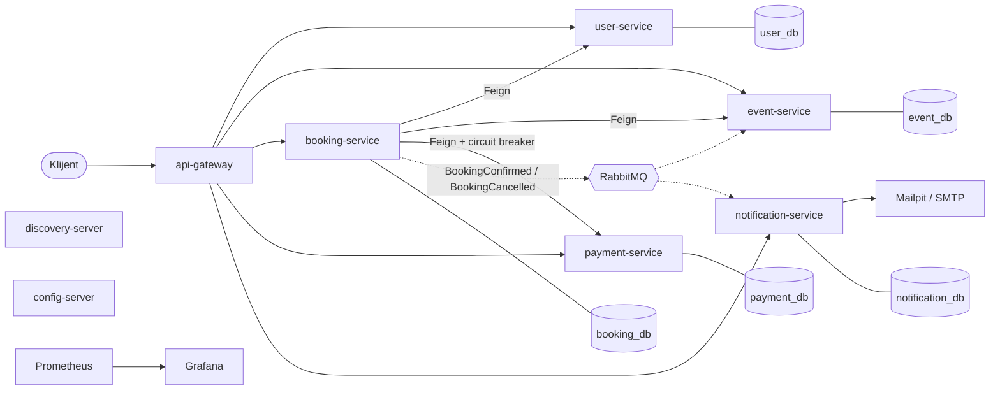

# Sistem za prodaju karata za događaje

Sistem za prodaju karata za događaje predstavlja mikroservisni sistem
napravljen u Spring Boot-u i Spring Cloud-u, gde korisnik može da pregleda događaje
(koncerte, predstave i sl.), da rezerviše karte i da ih plati. Kad je kupovina uspešna,
stiže mu mejl potvrda, a broj slobodnih mesta za događaj se smanjuje.

Tehnologije: Java 21, Spring Boot 4.1.1, Spring Cloud 2025.1.3, PostgreSQL, RabbitMQ, Docker,
GitHub Actions, Prometheus i Grafana.

## Poslovna logika

Sistem ima 5 mikroservisa i svaki ima svoju bazu:

- **user-service** (8081) - korisnici
- **event-service** (8082) - događaji i broj slobodnih mesta
- **booking-service** (8083) - rezervacije, poziva ostale servise
- **payment-service** (8084) - simulirano plaćanje
- **notification-service** (8085) - slanje mejlova

Ostale komponente:

- **api-gateway** (8080) - svi zahtevi idu preko njega
- **discovery-server** (8761) - Eureka, servisi se tu registruju
- **config-server** (8888) - konfiguracija svih servisa, nalazi se u folderu `config-repo/`
- **RabbitMQ** - za slanje poruka između servisa
- **Zipkin**, **Prometheus**, **Grafana** - praćenje i monitoring
- **Mailpit** - lažni mejl server za testiranje

### Kako radi rezervacija

1. Korisnik pošalje zahtev za rezervaciju, gateway ga prosledi na `booking-service`.
2. `booking-service` proveri da li korisnik postoji i da li ima slobodnih mesta (sinhrono, Feign).
3. Zatim poziva `payment-service` da plati. Ovaj poziv ima circuit breaker, pa ako
   `payment-service` ne radi, rezervacija ostaje u statusu `PENDING_PAYMENT` i može da se plati kasnije.
4. Ako je plaćanje prošlo, rezervacija je `CONFIRMED` i šalje se poruka `BookingConfirmed`
   na RabbitMQ (asinhrono).
5. `event-service` primi poruku i smanji broj mesta, a `notification-service` pošalje mejl.

Kod otkazivanja se šalje `BookingCancelled`, mesta se vraćaju i šalje se mejl o otkazivanju.

Statusi rezervacije: `PENDING_PAYMENT`, `CONFIRMED`, `CANCELLED`, `PAYMENT_FAILED`.

## Dijagram



Pune linije su sinhroni pozivi (HTTP), isprekidane su poruke preko RabbitMQ-a. Svi servisi se
registruju na Eureku i uzimaju konfiguraciju sa config-server-a.

## Šta je potrebno

- Java 21
- Docker Desktop
- Git

Maven nije potreban jer projekat ima `mvnw`. Na Windows-u u PowerShell-u umesto `./mvnw` ide `.\mvnw.cmd`.

Lozinke nisu u kodu, nego u `.env` fajlu koji se ne nalazi na Git-u. U projektu postoji
template `.env.example` sa praznim vrednostima. Treba ga kopirati u `.env`:

```bash
cp .env.example .env
```

i popuniti vrednosti. Za dev mogu da se izmisle bilo koja imena i lozinke, na primer:

```
USER_DB_USERNAME=user_app
USER_DB_PASSWORD=user123
EVENT_DB_USERNAME=event_app
EVENT_DB_PASSWORD=event123
BOOKING_DB_USERNAME=booking_app
BOOKING_DB_PASSWORD=booking123
PAYMENT_DB_USERNAME=payment_app
PAYMENT_DB_PASSWORD=payment123
NOTIFICATION_DB_USERNAME=notification_app
NOTIFICATION_DB_PASSWORD=notification123
RABBITMQ_USERNAME=ticketing
RABBITMQ_PASSWORD=rabbit123
GRAFANA_ADMIN_USER=admin
GRAFANA_ADMIN_PASSWORD=grafana123
ALERT_EMAIL_TO=admin@ticketing.local
```

Za dev nije potrebno popuniti `MAIL_*` polja jer se koristi Mailpit.

## Build i testovi

```bash
./mvnw clean verify
```

Ova komanda build-uje sve module i pokreće unit i integracione testove. Docker mora da bude
upaljen jer integracioni testovi pokreću PostgreSQL i RabbitMQ preko Testcontainers-a.

Za samo jedan servis:

```bash
./mvnw -pl booking-service clean verify
```

## Pokretanje - dev

```bash
docker compose up -d --build
```

Prvo pokretanje traje malo duže. Stanje i logovi:

```bash
docker compose ps
docker compose logs -f booking-service
```

Adrese:

| | |
| --- | --- |
| API Gateway | http://localhost:8080 |
| Eureka | http://localhost:8761 |
| RabbitMQ | http://localhost:15672 |
| Mailpit | http://localhost:8025 |
| Zipkin | http://localhost:9411 |
| Prometheus | http://localhost:9090 |
| Grafana | http://localhost:3000 |

Ponovni build samo jednog servisa:

```bash
docker compose up -d --build booking-service
```

Gašenje:

```bash
docker compose down       # podaci ostaju
docker compose down -v    # brišu se i baze
```

## CI/CD (GitHub Actions)

Workflow-i su u `.github/workflows/`.

**CI** (`ci.yml`) se pokreće na svaki push i pull request. Radi `./mvnw clean verify`, znači
build i sve testove.

**CD** (`cd.yml`) se pokreće kad CI prođe na `main` grani (može i ručno iz Actions taba).
Napravi Docker image za svaki servis i postavi ga na GitHub Container Registry sa tagovima
`latest` i SHA commit-a, npr. `ghcr.io/ivanamladenovic325/booking-service:latest`.

```
push -> CI (testovi) -> ako je main i testovi prođu -> CD (Docker image-i na GHCR) -> deploy
```

## Pokretanje - prod

Za produkciju se ne build-uje lokalno, nego se koriste image-i sa GHCR-a. Fajl
`docker-compose.prod.yml` menja osnovni compose: uključuje `prod` profil, otvara samo portove
8080 i 3000, a mejlovi idu preko pravog SMTP servera umesto Mailpit-a.

1. U `.env` popuniti SMTP podatke, npr. za Gmail (treba App Password):

   ```
   MAIL_HOST=smtp.gmail.com
   MAIL_PORT=587
   MAIL_USERNAME=...
   MAIL_PASSWORD=...
   MAIL_FROM=...
   ALERT_EMAIL_TO=...
   ```

2. Ako su image-i privatni, prvo login na GHCR:

   ```bash
   docker login ghcr.io -u <github-korisnik>
   ```

3. Ako radi dev verzija, prvo nju ugasiti (`docker compose down`), pa pokrenuti:

   ```bash
   docker compose -f docker-compose.yml -f docker-compose.prod.yml up -d
   ```

   Posle pokretanja treba sačekati minut da se servisi međusobno pronađu preko Eureke.

4. Gašenje:

   ```bash
   docker compose -f docker-compose.yml -f docker-compose.prod.yml down
   ```

Za neku stariju verziju u `.env` se stavi `IMAGE_TAG=<sha commit-a>` umesto `latest`.

### Test produkcije lokalno, bez Gmail-a

Prod može da se proba i na svom računaru sa Mailpit-om umesto pravog SMTP-a. U `.env` se stavi:

```
MAIL_HOST=mailpit
MAIL_PORT=1025
MAIL_FROM=noreply@ticketing.local
MAIL_SMTP_AUTH=false
MAIL_SMTP_STARTTLS=false
ALERT_EMAIL_TO=admin@ticketing.local
```

i pokrene se sa `--profile mailpit` (u prod-u je Mailpit inače isključen):

```bash
docker compose -f docker-compose.yml -f docker-compose.prod.yml --profile mailpit up -d
docker compose -f docker-compose.yml -f docker-compose.prod.yml --profile mailpit down
```

Da je to stvarno prod: kod servisa u `docker compose ps` piše image `ghcr.io/...`, a
`http://localhost:8081` ne radi (otvoren je samo gateway na 8080).

## Monitoring

Prometheus skuplja metrike sa svih servisa, a Grafana se sama podesi pri pokretanju (fajlovi su
u `monitoring/`). Login za Grafanu je iz `.env`.

Dashboard-i: JVM, HTTP zahtevi i circuit breaker.

Alarmi koji šalju mejl:
- circuit breaker je OPEN
- neki servis ne radi
- previše 5xx grešaka

U dev-u mejlovi stižu u Mailpit.

## Primer korišćenja

```bash
# korisnik
curl -X POST http://localhost:8080/api/users \
  -H "Content-Type: application/json" \
  -d '{"firstName":"Marko","lastName":"Marković","email":"marko@example.com"}'

# događaj
curl -X POST http://localhost:8080/api/events \
  -H "Content-Type: application/json" \
  -d '{"name":"Koncert","description":"Rok koncert","venue":"Arena","dateTime":"2027-06-15T20:00:00","totalSeats":100,"ticketPrice":2500.00}'

# rezervacija
curl -X POST http://localhost:8080/api/bookings \
  -H "Content-Type: application/json" \
  -d '{"userId":1,"eventId":1,"numberOfTickets":2}'

# plaćanje rezervacije koja je ostala PENDING_PAYMENT
curl -X POST http://localhost:8080/api/bookings/1/pay

# otkazivanje
curl -X PUT http://localhost:8080/api/bookings/1/cancel
```

Posle rezervacije mejl se vidi u Mailpit-u, a događaj ima 2 slobodna mesta manje.

## Testiranje circuit breaker-a

Najlakše je ugasiti `payment-service`:

```bash
docker compose stop payment-service
```

Posle nekoliko rezervacija circuit breaker prelazi u OPEN, rezervacije ostaju `PENDING_PAYMENT`
i stiže alarm na mejl. Ponovo se pali sa:

```bash
docker compose start payment-service
```

Drugi način je da se u `config-repo/payment-service.yml` stavi `failure-rate: 1.0` i onda pozove:

```bash
curl -X POST http://localhost:8084/actuator/refresh
```
